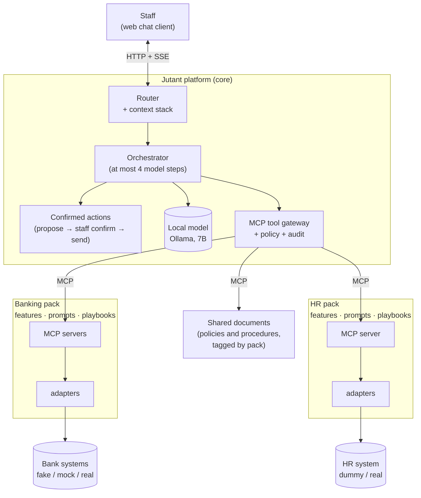
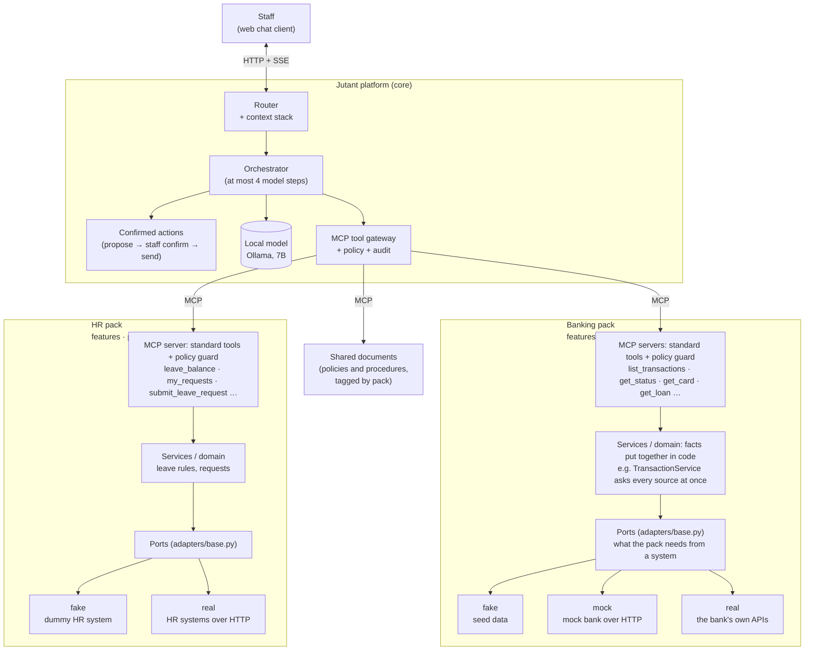

# Jutant

Jutant is an **architecture for enterprise AI assistants**: assistants that run on a local model, stay reliable when that model is small, and scale across business areas and organisations without being rebuilt. The chat staff see is the visible part. The work is underneath:

- **A conversation engine that understands intent in layers.** Jutant works out what a message is for before answering it: which kind of help (intent), which details it names (an account number, a date, a period), and what it continues (a stack of subjects, so follow-ups stay with the right one). Code decides first, from the pack's patterns and examples compared by meaning. When the pack cannot tell, the language model chooses, from a short list of options that code checks. If the model cannot tell either, the assistant asks staff with one short choice. Missing details are asked for one step at a time, and procedures run as playbooks.
- **A core that knows no business.** `core/` holds the engine, policy, tools and audit, with no framework and no business words. A business area arrives as a **pack**: its features, prompts, playbooks and tools.
- **Standard services per domain.** Each pack offers a fixed set of tools, whatever systems sit behind them. One pack runs at any organisation, and only the adapters change.
- **Scale by adding, not changing.** A new business area is a new pack. A new client is new adapters. A new model is a setting. Several packs run as one assistant.
- **Safe by construction.** Every tool sits behind MCP and a policy guard that checks the caller's role in that pack. Every call is audited. The model can propose a change, but only a person can send it.

To demonstrate the pack concept, it comes with two packs: a **banking** pack for branch staff and an **HR** pack for every employee. A teller who is also an employee asks about a customer's card and then their own leave in the same conversation, without picking a pack.

## Architecture

Staff talk to one assistant. The platform works out which kind of help a question needs. Every lookup or action goes through the gateway, which checks the caller's role in that pack and audits the call. Each pack reaches only its own systems, through its own adapters.

### Expanded diagram: the standard service layers

The same picture with each pack opened up. Inside a pack, every system sits behind the same layers, so the assistant always sees one standard set of tools, whatever system answers.

| Layer | Does | Example |
| --- | --- | --- |
| MCP server | Offers the standard tools and checks each call against the pack's policy | `list_transactions`, `leave_balance` |
| Services / domain | Puts the facts together in code, so the model only words them | `TransactionService` asks every system that records the channel, at once, merges the answers and reports any that did not answer |
| Port | Says what the pack needs from a system, in the pack's own terms | `TransactionSource`, the HR system's port |
| Adapter | Talks to one system: a fake with seed data, a mock over HTTP, or the real one | chosen by `JUTANT_BANKING_ADAPTERS` / `JUTANT_HR_ADAPTERS` |

Connecting a new bank or HR system means writing an adapter behind the port. Nothing above it changes: not the tools, the prompts or the conversation. The fakes and mocks let the whole system run, and be evaluated, before any real system is connected.

## Standard domain services

Each domain offers a **stable, standard set of services**. The assistant, the prompts and the playbooks always see the same service and tool names. What changes from one organisation to the next is only how those services are carried out, which means the adapters that reach that organisation's systems.

| Domain | Service | Tools |
| --- | --- | --- |
| Banking | accounts | `get_status`, `get_mandate`, `list_charges`, `list_standing_orders`, `get_cheque` |
| | transactions | `list_transactions`, `get_status` |
| | cards | `list_cards`, `get_card` |
| | lending | `list_facilities`, `get_loan`, `get_deposit` |
| | services | `search_products`, `get_product`, `get_requirements`, `summary` |
| HR | hr | `my_profile`, `leave_balance`, `leave_types`, `holidays`, `my_requests`, `get_request`, `propose_*` / `submit_*` (leave request, help request, comment, contact) |
| Shared | documents | `search`, `get` |

A bank that keeps transactions in two systems still has one `list_transactions`, because its `TransactionService` asks both and merges the answers. An organisation with a different HR system still has one `leave_balance`. A new client means new adapters behind the same tools.

Transactions is the first service built over several systems. The other services follow the same pattern over one adapter each today, and take more systems the same way when a client needs it.

### Why standard services

**For the model**

- **A small model learns one vocabulary.** Prompts, feature descriptions and tool examples are written and tuned once against fixed names. If each client's tools had different names, every deployment would need its prompts tuned again.
- **Evals stay comparable.** The same questions run against the same tools for every client and every model, so a score means the same thing everywhere.

**For the product**

- **One pack serves many clients.** For example the banking pack is written once and can be deployed to any banking environment. Only the adapters are written for each bank.
- **Clients' systems are messy and different.** One bank keeps transactions in two systems, while another has one core system with mobile money on the side. The service layer takes in that difference, so staff and the assistant never see it.
- **The conversation doesn't change when the systems do.** Replacing a core banking system or adding a payroll provider is adapter work. Staff keep asking the same questions the same way.

**For delivery**

- **It works before integration.** The fakes and mocks implement the same services, so a pack can be built, demonstrated and evaluated before the client's systems are reachable.
- **Integration has a clear scope.** For a new client, the job is "fill these ports", a fixed list of what the pack needs from their systems.
- **Work can be split.** One person builds the conversation and the features, and another builds the adapters to the client's API, without getting in each other's way.

**For safety and control**

- **Policy is written against stable names.** Role rules, the guard on each MCP server and the audit log all refer to the same tools. A new client doesn't open new paths around them.
- **Facts are assembled in one place.** The domain layer puts the facts together in code once. Every client gets the same reliable answer shape, however their system returns the data.

## Key decisions

- **A platform core and business-area packs.** `core/` imports no framework and uses no business words. Packs import only `core/`, and all wiring is in `config/container.py`. `lint-imports` enforces this in CI. A new business area is a new pack, not a change to the core.
- **A local model, so data never leaves the organisation.** Enterprises do not want staff questions, customer records or employee data sent to an outside AI service, so the model runs on the organisation's own machines (Ollama).
- **The model is easy to change.** The core talks to the model only through its `ModelProvider` port. Another Ollama model is one setting (`JUTANT_LLM_MODEL`); another runtime is one provider file in `providers/llm/` and a branch in its factory. Nothing in the core or the packs depends on which model answers (see [The model](#the-model)).
- **Every tool is behind MCP, with a guard.** The assistant reaches systems only through MCP servers. Each server checks every call against the caller's role and the pack's policy, and the gateway audits it, so a confused model cannot reach what the person may not.
- **Standard tools over adapters.** Each pack's tools stay the same whatever system answers, so connecting a client's systems never changes the conversation (see the expanded diagram).
- **Changes only through confirmed actions.** The model can propose a request but never send one. A staff member confirms it on a card. A confirmation is claimed once and a repeated send has no extra effect, and an unconfirmed proposal expires after 10 minutes.
- **Several packs as one assistant, with scoped ids.** Staff should not have to know which pack answers. With several packs, ids are scoped (`banking.get_details`, `hr.get_details`), roles are set per pack, and packs whose servers, playbooks or entities clash refuse to start.
- **Ask, don't guess.** When a question could mean two things, the assistant offers one short choice. There are no fixed quick-action buttons and no forced routing.
- **Intent is decided in layers: code, then meaning, then the model, then staff.** A small model is reliable choosing from a short list, not deciding the whole flow, so it is asked only when patterns and meaning are not sure, and its choice is checked. Each decision is audited with the step that made it, so a misroute can be traced.
- **Context as a stack of subjects.** The engine keeps a stack of subjects rather than a flat history, so side questions and paused procedures don't leak into each other.
- **Django for persistence only, FastAPI for the API.** Each framework stays at its edge, and the core never sees either.
- **One database.** PostgreSQL with pgvector holds both the records and the document search, so there is no separate vector store to run.
- **Observability behind a port.** Tracing goes through `core/observability`, with OpenTelemetry behind it in `providers/tracing`, so Phoenix can be replaced by any backend that speaks OpenTelemetry.

## The model

Today the assistant runs on **Qwen 2.5 7B** through Ollama, with `nomic-embed-text` for document search. This is a choice made for the environment, not a limit of the design.

**Why this model.** The development and testing machine had CPUs only, no GPU. A 7B model is about the largest that answers in reasonable time there, and Qwen 2.5 7B follows instructions and calls tools well for its size. It is also a realistic floor: an organisation that keeps its data in-house may start on modest hardware too.

**What it shaped.** A small model on a CPU is slower and more easily confused than a large one, so the work it is given is kept small:

- Prompts are short: the system prompt under 150 words, a feature's under 120.
- A question takes at most four model steps.
- The model sees only the tools of the feature a question was routed to.
- Whatever code can do reliably is done in code: routing a question that is clear, asking for missing details, choosing a playbook's next step, putting a record's facts together, answering "that isn't shown", and checking every tool call (one retry, then a clean failure).

These choices make the assistant faster and more predictable on any model, so they stay when the model changes.

**Changing it.** Set `JUTANT_LLM_MODEL` (and `JUTANT_LLM_BASE_URL` if the model runs elsewhere) to use another Ollama model, for example a larger one on a GPU. To use another runtime, add a provider in `providers/llm/` and a branch in `providers/llm/factory.py`, then set `JUTANT_LLM_PROVIDER`. Run the evals (`manage.py run_evals --model <name>`) to compare models on the same questions.
